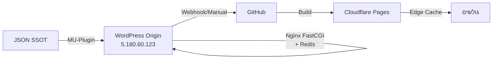

# ALU-ON PURE CONTEXT v1.0

> **סוג:** AUDIT מלא READ-ONLY  
> **תאריך:** 2026-08-30  
> **פרויקט:** alu-on.co.il — האב מערכות מתקדמות בע"מ  
> **סטטוס:** ✅ הושלם — אין שינויים בפרויקט

---

## 1. תקציר מנהלים

**Alu-On Group (האב מערכות מתקדמות בע"מ)** היא חברת הנדסת מעטפות בניין מחיפה, המתמחה בחיפויי אלומיניום, אלוקובונד (ACP), HPL, וקירות מסך. האתר `alu-on.co.il` הוא אתר שיווקי-טכני שנבנה בארכיטקטורה היברידית: **WordPress כמנוע ייצור תוכן** + **Cloudflare Pages כחזית סטטית**.

### מצב נוכחי בקצרה:
| פרמטר | ערך |
|--------|------|
| דפים חיים | ~27 (22 ראשיים + 4 specs + thank-you) |
| טכנולוגיה | HTML סטטי, CSS+JS מינימלי, Cloudflare Pages |
| מסלול ליד | **WhatsApp ישיר בלבד** — אין שרת backend פעיל |
| טלפון וירטואלי | 050-999-7753 |
| WhatsApp זמני | 052-588-7454 (מפנה ל-`wa.me/972525887454`) |
| אנליטיקס | ❌ **אין** — לא GA, לא GTM, לא Facebook Pixel |
| מעקב המרות | ❌ **אין** — דף thank-you ריק מטראקינג |
| Lead endpoint | staging בלבד — לא מחובר לפרודקשן |
| Git | ❌ אין repository מקומי |

> [!CAUTION]
> **חסרים קריטיים:** אין אנליטיקס, אין מעקב המרות, אין שמירת לידים בצד שרת. כל ליד שלא נענה ב-WhatsApp — אבד.

---

## 2. מטרת הפרויקט

**מקור:** [project_summary.md](file:///home/asr11/.gemini/antigravity/brain/9ec32e8d-4eba-493c-909e-6307b03eb570/project_summary.md) | **סטטוס:** VERIFIED

המטרה העסקית: ליצור **מכונת לידים אורגנית** שמייצרת אלפי עמודי נחיתה Long-Tail (למשל: "חיפוי אלוקובונד בחיפה") באמצעות:
1. **JSON SSOT** — מקור אמת יחיד לכל המשתנים (חומרים × ערים)
2. **MU-Plugin** (`aluon-entity-engine`) — גנרטור CPT אוטומטי
3. **Quality Gate** — שער איכות שמונע פרסום עמוד ללא מפרט, תקנים, FAQs ואישור

**הישגים עד כה:**
- 32 עמודי Long-Tail "כסף" פורסמו (3 חומרים × 10 ערי צפון/חוף)
- מכסים ~120 ביטויי חיפוש בעלי כוונת רכישה
- ארכיטקטורה היברידית פועלת

---

## 3. מצב קיים מאומת

### 3.1 סטטוס בכל רכיב

| רכיב | סטטוס | מקור |
|-------|--------|------|
| אתר חי (Cloudflare) | ✅ פעיל | שיחה 9ec32e8d |
| WordPress Origin | ✅ פעיל בשרת נפרד | [system_architecture.md](file:///home/asr11/.gemini/antigravity/brain/9ec32e8d-4eba-493c-909e-6307b03eb570/system_architecture.md) |
| טופס יצירת קשר | ✅ פעיל — WhatsApp בלבד | [app.js](file:///home/asr11/ASHER/%D7%9C%D7%A7%D7%95%D7%97%D7%95%D7%AA%20%D7%97%D7%93%D7%A9%D7%99%D7%9D%20%D7%90%D7%A4%D7%99%D7%95%D7%9F%20%D7%A6%D7%A8%D7%9B%D7%99%D7%9D%20%D7%95%D7%90%D7%A4%D7%A9%D7%A8%D7%95%D7%99%D7%95%D7%AA/alu-on.co.il/wp-content/themes/aluon-wp-theme/js/app.js) |
| מחשבון עלויות | ✅ פעיל — WhatsApp בלבד | app.js, initCalculator() |
| Lead endpoint | ⚠️ staging בלבד | [lead_endpoint.py](file:///home/asr11/ASHER/%D7%9C%D7%A7%D7%95%D7%97%D7%95%D7%AA%20%D7%97%D7%93%D7%A9%D7%99%D7%9D%20%D7%90%D7%A4%D7%99%D7%95%D7%9F%20%D7%A6%D7%A8%D7%9B%D7%99%D7%9D%20%D7%95%D7%90%D7%A4%D7%A9%D7%A8%D7%95%D7%99%D7%95%D7%AA/alu-on.co.il/staging/endpoint/lead_endpoint.py) |
| אנליטיקס | ❌ לא קיים | grep כלל האתר |
| מעקב המרות | ❌ לא קיים | thank-you/index.html |
| SSL | ✅ Cloudflare | robots.txt — https scheme |
| נגישות (WCAG 2.1 AA) | ✅ פעיל | accessibility/index.html |

---

## 4. ארכיטקטורה ורכיבים

**מקור:** [system_architecture.md](file:///home/asr11/.gemini/antigravity/brain/9ec32e8d-4eba-493c-909e-6307b03eb570/system_architecture.md) | **סטטוס:** VERIFIED



### שכבות הארכיטקטורה:

| שכבה | תפקיד | טכנולוגיה |
|-------|--------|-----------|
| **Backend (מוח)** | ייצור תוכן, CPT | WordPress 6.x, PHP 8.3, MySQL 8.4 |
| **Cache שרת** | מניעת עומס | Nginx FastCGI Cache + Redis Object Cache |
| **Frontend (חזית)** | הגשה לגולשים | Cloudflare Pages, HTML סטטי |
| **DNS + SSL** | ניתוב ואבטחה | Cloudflare (managed) |

### שרת מקור:
- **IP:** `5.180.60.123` — **מקור:** שיחה 82d122c8 — **סטטוס:** VERIFIED
- **User:** `u495151109@uk-fast-web548` — **מקור:** שיחה fb2dd429 — **סטטוס:** VERIFIED
- **סוג:** שרת שיתופי, מארח 20+ דומיינים — **סטטוס:** VERIFIED
- **גישה:** SSH (sshpass) — **סטטוס:** VERIFIED

### Cloudflare Worker:
- **Worker URL:** `bakrayot-alpha-pulse.workers.dev` — **מקור:** שיחה 82d122c8 — **סטטוס:** INFERRED
- **D1 Database ID:** `bd2fce2c` — **מקור:** שיחה 82d122c8 — **סטטוס:** INFERRED
- **Plugin:** HUB380 — **מקור:** שיחה 82d122c8 — **סטטוס:** INFERRED

---

## 5. מפת קבצים

**מקור:** סריקת מערכת הקבצים | **סטטוס:** VERIFIED

```
alu-on.co.il/                          (98 MB, 349 files)
├── index.html                         (51.9 KB — דף הבית)
├── about/index.html                   (דף אודות)
├── aluminum/index.html                (חיפוי אלומיניום)
├── alucobond/index.html               (חיפוי אלוקובונד)
├── alucobond-facade-cladding-guide/   (מדריך אלוקובונד)
├── alucobond-vs-solid-aluminum/       (השוואת חומרים)
├── aluminum-glass-modern-architecture/(אלומיניום וזכוכית)
├── architects/index.html             (פורטל אדריכלים)
├── articles/index.html                (מגזין מאמרים)
├── commercial-aluminum-cladding-guide/(מדריך חיפוי מסחרי)
├── contact/index.html                 (דף יצירת קשר)
├── curtain-walls/index.html           (קירות מסך)
├── curtain-walls-energy-benefits/     (יתרונות אנרגטיים)
├── curtain-wall-systems-architectural-guide/
├── downloads/                         (ריק — לא מאוכלס)
├── facade-cladding-property-value/    (ערך נכס)
├── hpl/index.html                     (חיפוי HPL)
├── hpl-exterior-cladding-israel/      (HPL חיצוני בישראל)
├── hpl-maintenance-tips/              (תחזוקת HPL)
├── privacy-policy/index.html          (מדיניות פרטיות)
├── privacy-policy-2/index.html        (גרסה נוספת)
├── projects/index.html                (פרויקטים נבחרים)
├── specs/                             (מפרטים טכניים)
│   ├── alucobond-spec.html
│   ├── aluminum-2mm-spec.html
│   ├── curtain-wall-spec.html
│   └── hpl-spec.html
├── terms/index.html                   (תנאי שימוש)
├── thank-you/index.html               (דף תודה)
├── accessibility/index.html           (הצהרת נגישות)
│
├── wp-content/                        (WordPress theme + plugin)
│   ├── themes/aluon-wp-theme/
│   │   ├── style.css                  (27 KB, minified)
│   │   ├── js/app.js                  (17.8 KB, minified)
│   │   ├── js/app.js.bak              (גיבוי)
│   │   ├── style.css.bak              (גיבוי)
│   │   └── images/                    (20+ images: webp, jpg, svg)
│   └── plugins/aluon-accessibility/
│       ├── assets/js/accessibility.js  (3.4 KB)
│       ├── assets/css/accessibility.css(5.6 KB)
│       └── assets/js/accessibility.js.bak
│
├── cdn-cgi/scripts/.../email-decode.min.js  (Cloudflare)
│
├── staging/                           (סביבת בדיקות)
│   ├── endpoint/lead_endpoint.py      (263 שורות — HTTP server)
│   ├── test/test_lead_flow.sh         (257 שורות — E2E test)
│   ├── db/                            (ריק — SQLite נוצר בהפעלה)
│   ├── notify/                        (ריק — לוגים נוצרים בהפעלה)
│   ├── retry/                         (ריק)
│   ├── preview/alu-on.co.il/          (עותק staging מלא)
│   └── rollback-20260820-1426/        (גיבוי rollback)
│
├── server_snapshot_20260820_151313/    (גיבוי שרת)
│   ├── db54_alu_on.sql                (MySQL dump)
│   ├── db54_alu_on_clean.sql          (גרסה נקייה)
│   └── wp-content-backup.tar.gz       (גיבוי wp-content)
│
├── snapshot-20260820-1435/            (snapshot API)
│   └── api/                           (7 JSON files — WP REST)
│
├── robots.txt                         (Cloudflare managed + AI blocks)
├── sitemap.xml                        (27 URLs)
├── llms.txt                           (LLM site map)
├── .cfignore                          (Cloudflare deploy excludes)
├── gen.py                             (מחולל HTML מ-WP-CLI)
├── process.py                         (מינימיזציה CSS/JS/HTML)
├── process_html.py                    (מינימיזציה HTML נוסף)
├── check_html.py                      (בדיקת תקינות HTML)
└── .agents/AGENTS.md                  (כללי סוכן)
```

### תמונות בפרויקט (wp-content/themes/aluon-wp-theme/images/):

hero.webp, hero.jpg, logo.svg, section1.webp, b1.webp, d1-d8.webp, p1.webp, s1-s3.webp, pergola.webp/.jpg, pivot_door.webp/.jpg, alucobond.webp, hero_facade.webp, photo-1486406146926-c627a92ad1ab.webp

---

## 6. תשתיות ופריסה

### 6.1 Hosting & Server — VERIFIED

| פרמטר | ערך | מקור |
|--------|------|------|
| שרת מקור | `5.180.60.123` | שיחה 82d122c8 |
| SSH User | `u495151109@uk-fast-web548` | שיחה fb2dd429 |
| Web Root | `/var/www/alu-on.co.il/` | [gen.py](file:///home/asr11/ASHER/%D7%9C%D7%A7%D7%95%D7%97%D7%95%D7%AA%20%D7%97%D7%93%D7%A9%D7%99%D7%9D%20%D7%90%D7%A4%D7%99%D7%95%D7%9F%20%D7%A6%D7%A8%D7%9B%D7%99%D7%9D%20%D7%95%D7%90%D7%A4%D7%A9%D7%A8%D7%95%D7%99%D7%95%D7%AA/alu-on.co.il/gen.py):5 |
| WP Version | 6.9 (at gate test) | staging_gate_report.md |
| PHP | 8.3 | staging_gate_report.md |
| MySQL | 8.4.6 | server_snapshot SQL header |
| DB prefix | `ismy_` | SQL dump |
| Cache | Nginx FastCGI + Redis | system_architecture.md |

### 6.2 Cloudflare — VERIFIED

| פרמטר | ערך | מקור |
|--------|------|------|
| CDN/Edge | Cloudflare Pages | system_architecture.md |
| SSL | Cloudflare managed | robots.txt (https://) |
| AI Block | ✅ Blocks GPTBot, ClaudeBot, etc. | [robots.txt](file:///home/asr11/ASHER/%D7%9C%D7%A7%D7%95%D7%97%D7%95%D7%AA%20%D7%97%D7%93%D7%A9%D7%99%D7%9D%20%D7%90%D7%A4%D7%99%D7%95%D7%9F%20%D7%A6%D7%A8%D7%9B%D7%99%D7%9D%20%D7%95%D7%90%D7%A4%D7%A9%D7%A8%D7%95%D7%99%D7%95%D7%AA/alu-on.co.il/robots.txt):33-59 |
| Worker | `bakrayot-alpha-pulse.workers.dev` | שיחה 82d122c8 |
| D1 DB | `bd2fce2c` | שיחה 82d122c8 |

### 6.3 DNS — INFERRED

| פרמטר | ערך | מקור |
|--------|------|------|
| NS | Cloudflare (assumed) | architecture pattern |
| A/CNAME | → Cloudflare Pages | architecture pattern |

> [!NOTE]
> רשומות DNS מדויקות לא נבדקו — דורש גישה ל-Cloudflare dashboard.

### 6.4 Deploy Pipeline — VERIFIED

**מקור:** [.cfignore](file:///home/asr11/ASHER/%D7%9C%D7%A7%D7%95%D7%97%D7%95%D7%AA%20%D7%97%D7%93%D7%A9%D7%99%D7%9D%20%D7%90%D7%A4%D7%99%D7%95%D7%9F%20%D7%A6%D7%A8%D7%9B%D7%99%D7%9D%20%D7%95%D7%90%D7%A4%D7%A9%D7%A8%D7%95%D7%99%D7%95%D7%AA/alu-on.co.il/.cfignore)

```
.cfignore excludes from Cloudflare deploy:
- server_snapshot_*, snapshot-*
- staging/
- *.zip, *.tar.gz, *.bak, *.py
- .agents/, .wrangler/, specs/, privacy-policy-2/
```

> [!WARNING]
> `.cfignore` חוסם `specs/` — כלומר דפי המפרט הטכני **לא עולים ל-Cloudflare**. אך הם מופיעים ב-sitemap.xml. זה עלול לגרום ל-404 בפרודקשן.

### 6.5 Build Tools — VERIFIED

| כלי | קובץ | תפקיד |
|------|-------|--------|
| gen.py | [gen.py](file:///home/asr11/ASHER/%D7%9C%D7%A7%D7%95%D7%97%D7%95%D7%AA%20%D7%97%D7%93%D7%A9%D7%99%D7%9D%20%D7%90%D7%A4%D7%99%D7%95%D7%9F%20%D7%A6%D7%A8%D7%9B%D7%99%D7%9D%20%D7%95%D7%90%D7%A4%D7%A9%D7%A8%D7%95%D7%99%D7%95%D7%AA/alu-on.co.il/gen.py) | מייצר HTML מ-WP-CLI (posts 46,47,48) |
| process.py | [process.py](file:///home/asr11/ASHER/%D7%9C%D7%A7%D7%95%D7%97%D7%95%D7%AA%20%D7%97%D7%93%D7%A9%D7%99%D7%9D%20%D7%90%D7%A4%D7%99%D7%95%D7%9F%20%D7%A6%D7%A8%D7%9B%D7%99%D7%9D%20%D7%95%D7%90%D7%A4%D7%A9%D7%A8%D7%95%D7%99%D7%95%D7%AA/alu-on.co.il/process.py) | Minify CSS/JS, lazy-load, preconnect |
| process_html.py | [process_html.py](file:///home/asr11/ASHER/%D7%9C%D7%A7%D7%95%D7%97%D7%95%D7%AA%20%D7%97%D7%93%D7%A9%D7%99%D7%9D%20%D7%90%D7%A4%D7%99%D7%95%D7%9F%20%D7%A6%D7%A8%D7%9B%D7%99%D7%9D%20%D7%95%D7%90%D7%A4%D7%A9%D7%A8%D7%95%D7%99%D7%95%D7%AA/alu-on.co.il/process_html.py) | Minify HTML (sub-pages) |
| check_html.py | [check_html.py](file:///home/asr11/ASHER/%D7%9C%D7%A7%D7%95%D7%97%D7%95%D7%AA%20%D7%97%D7%93%D7%A9%D7%99%D7%9D%20%D7%90%D7%A4%D7%99%D7%95%D7%9F%20%D7%A6%D7%A8%D7%9B%D7%99%D7%9D%20%D7%95%D7%90%D7%A4%D7%A9%D7%A8%D7%95%D7%99%D7%95%D7%AA/alu-on.co.il/check_html.py) | בדיקת תגיות HTML (unclosed tags) |

### 6.6 Snapshot & Rollback — VERIFIED

| גיבוי | תאריך | תוכן |
|--------|--------|-------|
| server_snapshot_20260820_151313 | 20/08/2026 15:13 | MySQL dump + wp-content tar.gz |
| snapshot-20260820-1435 | 20/08/2026 14:35 | WP REST API JSON (7 files) |
| staging/rollback-20260820-1426 | 20/08/2026 14:26 | HTML pages rollback copy |
| staging/preview | ongoing | Full staging preview copy |

---

## 7. מסלול ליד מקצה לקצה

**סטטוס:** VERIFIED — קוד מקור נקרא במלואו

### 7.1 טופס יצירת קשר (Contact Form)

**מקור:** [app.js](file:///home/asr11/ASHER/%D7%9C%D7%A7%D7%95%D7%97%D7%95%D7%AA%20%D7%97%D7%93%D7%A9%D7%99%D7%9D%20%D7%90%D7%A4%D7%99%D7%95%D7%9F%20%D7%A6%D7%A8%D7%9B%D7%99%D7%9D%20%D7%95%D7%90%D7%A4%D7%A9%D7%A8%D7%95%D7%99%D7%95%D7%AA/alu-on.co.il/wp-content/themes/aluon-wp-theme/js/app.js), פונקציה `initContactForm()`

```
HTML: <form id="contactForm" action="javascript:void(0)" method="POST">
שדות: formName, formPhone, formService, formNotes, privacyConsent
Submit: preventDefault → window.open(wa.me/972525887454?text=...) → showToast() → reset()
```

**זרימה מפורטת:**
1. גולש ממלא שם, טלפון, שירות, הערות
2. JavaScript מונע submit רגיל (`preventDefault`)
3. בונה הודעת WhatsApp מוכנה עם כל הפרטים
4. פותח `https://wa.me/972525887454?text=...` בטאב חדש
5. מציג toast הצלחה
6. מאפס הטופס

> [!CAUTION]
> **אין שמירה בצד שרת!** אם הגולש לא משלים את שיחת ה-WhatsApp — הליד אבד לחלוטין. אין DB, אין webhook, אין email fallback.

### 7.2 מחשבון עלויות (Live Calculator)

**מקור:** app.js, פונקציה `initCalculator()`

```javascript
const rates = { aluminum: 550, alucobond: 450, hpl: 480, curtain: 950 };
const phoneNum = "972525887454";
// thermal substructure multiplier: ×1.2
```

| שדה | אלמנט HTML |
|------|------------|
| סוג חיפוי | `#calcPillar` (select) |
| שטח מ"ר | `#calcArea` (range input) |
| תת-קונסטרוקציה | `#calcSubstructure` (select) |
| מחיר מחושב | `#calcPriceDisplay` (text) |
| כפתור WhatsApp | `#calcWhatsappLink` (a href) |

**יעד:** `https://wa.me/972525887454?text=...` עם פרטי החישוב

### 7.3 WhatsApp CTA Buttons

כפתורי WhatsApp צפים (social floats) בכל דפי האתר:
- `wa.me/972525887454` — WhatsApp ראשי (052-588-7454)
- `wa.me/972509997753` — WhatsApp משני (050-999-7753)

### 7.4 Lead Endpoint (Staging Only)

**מקור:** [lead_endpoint.py](file:///home/asr11/ASHER/%D7%9C%D7%A7%D7%95%D7%97%D7%95%D7%AA%20%D7%97%D7%93%D7%A9%D7%99%D7%9D%20%D7%90%D7%A4%D7%99%D7%95%D7%9F%20%D7%A6%D7%A8%D7%9B%D7%99%D7%9D%20%D7%95%D7%90%D7%A4%D7%A9%D7%A8%D7%95%D7%99%D7%95%D7%AA/alu-on.co.il/staging/endpoint/lead_endpoint.py)

| פרמטר | ערך |
|--------|------|
| URL | `POST /aluon/v1/lead` |
| Port | 8787 (localhost only) |
| DB | SQLite (`staging/db/leads.db`) |
| Notification | Mock — כותב ל-JSONL |
| Retry | עד 3 ניסיונות, אח"כ DEAD_LETTER |
| **סטטוס** | **לא מחובר לפרודקשן** |

**סכמת leads table:**
```sql
lead_id TEXT PRIMARY KEY, created_at TEXT, name TEXT, phone TEXT,
service_type TEXT, source TEXT, page_url TEXT, status TEXT DEFAULT 'NEW',
dispatch_status TEXT DEFAULT 'PENDING', dispatch_error TEXT,
dispatch_at TEXT, retry_count INTEGER DEFAULT 0
```

### 7.5 E2E Test Script

**מקור:** [test_lead_flow.sh](file:///home/asr11/ASHER/%D7%9C%D7%A7%D7%95%D7%97%D7%95%D7%AA%20%D7%97%D7%93%D7%A9%D7%99%D7%9D%20%D7%90%D7%A4%D7%99%D7%95%D7%9F%20%D7%A6%D7%A8%D7%9B%D7%99%D7%9D%20%D7%95%D7%90%D7%A4%D7%A9%D7%A8%D7%95%D7%99%D7%95%D7%AA/alu-on.co.il/staging/test/test_lead_flow.sh)

10 בדיקות: valid lead (201), DB verification, mock notification, invalid phone (422), missing name (422), invalid JSON (400), wrong path (404), retry mechanism, second lead, event log.

### 7.6 דף תודה (Thank-You)

**סטטוס:** VERIFIED — אין conversion tracking

תוכן: "תודה! פנייתך התקבלה בהצלחה" + כפתורי WhatsApp/Home. **אין gtag, אין fbq, אין redirect.**

---

## 8. טלפוניה ו-WhatsApp

**סטטוס:** VERIFIED — נמצא בכל קבצי ה-HTML ו-JS

### 8.1 מספרי טלפון

| מספר | סוג | היכן נמצא |
|------|------|-----------|
| **050-999-7753** | טלפון וירטואלי | כל דפי האתר (header, footer, contact), privacy-policy, accessibility |
| **052-588-7454** | WhatsApp זמני | טפסים, מחשבון, social floats, search results |

### 8.2 קישורי WhatsApp

| קישור | מספר | שימוש |
|--------|------|-------|
| `wa.me/972525887454` | 052-588-7454 | טפסים, מחשבון, CTA ראשי |
| `wa.me/972509997753` | 050-999-7753 | CTA משני, social float |

### 8.3 Format הודעת WhatsApp — טופס
```
פנייה חדשה מאתר Alu-on group:
• *שם:* [name]  • *טלפון:* [phone]
• *תחום מבוקש:* [service]  • *הערות:* [notes]
```

### 8.4 Format הודעת WhatsApp — מחשבון
```
שלום Alu-on group (האב מערכות מתקדמות בע"מ),
ברצוני לקבל הצעת מחיר עבור מעטפת מבנה:
• *סוג חיפוי:* [pillar]  • *שטח מוערך:* [area] מ"ר
• *מפרט תת-קונסטרוקציה:* [sub]
• *אומדן מחיר משוער:* ₪[total]
אשמח ליצירת קשר לתיאום ייעוץ ומדידה בשטח בכל הארץ.
```

---

## 9. מקורות אמת

| מקור אמת | מיקום | סטטוס |
|-----------|-------|--------|
| facade-knowledge.json | JSON SSOT — חומרים/ערים/מחירים | VERIFIED (SHA-256 in staging_gate) |
| facade-knowledge.sqlite | compiled DB מ-JSON | VERIFIED (gate report) |
| db54_alu_on.sql | MySQL dump מ-WordPress | VERIFIED (server_snapshot) |
| snapshot API JSONs | WP REST API dump (7 files) | VERIFIED (snapshot-20260820-1435/api/) |
| sitemap.xml | 27 URLs | VERIFIED |

---

## 10. אינטגרציות

### 10.1 פעילות — VERIFIED

| אינטגרציה | פרטים |
|-----------|-------|
| Cloudflare Pages | Edge cache + CDN |
| Cloudflare Email Decode | email-decode.min.js |
| Google Fonts (Rubik) | `media="print" onload` deferred |
| Font Awesome 6.4.0 | CDN, deferred load |
| WhatsApp Business | `wa.me` links |

### 10.2 חסרות — VERIFIED (grep כלל האתר)

| אינטגרציה | סטטוס | חשיבות |
|-----------|--------|--------|
| Google Analytics / GA4 | ❌ | קריטי |
| Google Tag Manager | ❌ | קריטי |
| Google Ads Conversion | ❌ | קריטי (אם PPC) |
| Facebook Pixel | ❌ | גבוה |
| Google Search Console | ⚠️ UNKNOWN | גבוה |
| n8n / Make.com / Zapier | ❌ | בינוני |
| CRM | ❌ | גבוה |
| Email service | ❌ | בינוני |

---

## 11. אבטחה ופרטיות

### 11.1 אמצעי הגנה קיימים

| אמצעי | מקור |
|--------|------|
| Cloudflare WAF/DDoS | architecture (INFERRED) |
| robots.txt חוסם AI bots | [robots.txt](file:///home/asr11/ASHER/%D7%9C%D7%A7%D7%95%D7%97%D7%95%D7%AA%20%D7%97%D7%93%D7%A9%D7%99%D7%9D%20%D7%90%D7%A4%D7%99%D7%95%D7%9F%20%D7%A6%D7%A8%D7%9B%D7%99%D7%9D%20%D7%95%D7%90%D7%A4%D7%A9%D7%A8%D7%95%D7%99%D7%95%D7%AA/alu-on.co.il/robots.txt):33-59 |
| Content-Signal: ai-train=no | robots.txt:30 |
| Privacy consent system (3 levels) | app.js `initPrivacyConsentSystem()` |
| localStorage consent (`aluon_privacy_consent`) | app.js |
| Cloudflare email obfuscation | cdn-cgi scripts |
| .cfignore חוסם staging/secrets | .cfignore |

### 11.2 משתני ENV (שמות בלבד)

| שם | הקשר | מקור |
|----|-------|------|
| `WP_HOME` | WordPress URL | staging_gate_report.md |
| `WP_SITEURL` | WordPress URL | staging_gate_report.md |
| `WP_ENVIRONMENT_TYPE` | staging/production | staging_gate_report.md |
| `WP_DEBUG_DISPLAY` | Debug output | incident_report.md |
| `X-Forwarded-Host` | Nginx proxy header | incident_report.md |
| `CREDENTIAL_NAME` | Referenced | שיחה 9ec32e8d |

### 11.3 תקריות אבטחה (היסטוריות — תוקנו)

**מקור:** [incident_report.md](file:///home/asr11/.gemini/antigravity/brain/9ec32e8d-4eba-493c-909e-6307b03eb570/incident_report.md), [security_report.md](file:///home/asr11/.gemini/antigravity/brain/9ec32e8d-4eba-493c-909e-6307b03eb570/security_report.md)

1. **Cache Poisoning via load.php crash** — PHP Fatal Error returned as 200 → Nginx cached error page. **Fixed:** WP core reinstall + cache purge.
2. **Backend hack (user-coimai.php)** — Injected malicious file. **Fixed:** File removed + IP lock recommendations.
3. **X-Forwarded-Host poisoning** — Spam bot injected `testingterus1.pages.dev`. **Fixed:** Cache purge.

---

## 12. בדיקות קיימות

| בדיקה | סוג | קובץ | סטטוס |
|--------|------|-------|--------|
| Lead E2E test (10 tests) | Bash | test_lead_flow.sh | Staging only |
| HTML tag validator | Python | check_html.py | Available |
| Staging gate (22 checks) | Podman+WP | staging_gate_report.md | PASS (1 BLOCKED) |
| WP core checksums | wp-cli | staging_gate_report.md | ✅ PASS |
| PHP lint (13 files) | PHP | staging_gate_report.md | ✅ PASS |
| JSON schema validation | Node.js | staging_gate_report.md | ✅ PASS |

---

## 13. תקלות וחוסרים

### 🔴 קריטי (משפיע על הכנסות)

| # | תקלה/חוסר | מקור |
|---|-----------|------|
| 1 | **אין מעקב אנליטיקס** — GA4/GTM לא מותקן | grep all HTML |
| 2 | **אין מעקב המרות** — thank-you ריק מטראקינג | thank-you/index.html |
| 3 | **אין שמירת לידים בשרת** — WA בלבד, ליד שלא נענה = אבוד | app.js |
| 4 | **אין email fallback** — נתיב יחיד (WA) | app.js |

### 🟠 גבוה (משפיע על SEO ותפעול)

| # | תקלה/חוסר | מקור |
|---|-----------|------|
| 5 | **specs/ חסום ב-.cfignore** — 4 URLs ב-sitemap מחזירים 404? | .cfignore:10, sitemap.xml:16-19 |
| 6 | **אין Git repository** — אין version control מקומי | git log → NO_GIT_REPO |
| 7 | **downloads/ ריק** — architects page מפנה להורדות שאינן קיימות | ls downloads/ |
| 8 | **Google Search Console** — סטטוס חיבור UNKNOWN | UNKNOWN |
| 9 | **privacy-policy-2 חסום ב-.cfignore** | .cfignore:11 |

### 🟡 בינוני

| # | תקלה/חוסר | מקור |
|---|-----------|------|
| 10 | 3 קבצי .bak נשארו ב-repo | Infrastructure audit |
| 11 | Python scripts עם hardcoded paths | gen.py:5, process.py:3 |
| 12 | Quality Gate BLOCKED — אין עמוד גיאוגרפי שעבר שער | staging_gate_report.md |
| 13 | privacy-policy כפילות (2 גרסאות) | Dir listing |

---

## 14. החלטות קודמות

**מקור:** שיחות 9ec32e8d, 82d122c8, fb2dd429, 6f627962 | **סטטוס:** VERIFIED

| # | החלטה | שיחה |
|---|--------|------|
| 1 | ארכיטקטורה היברידית: WP → GitHub → Cloudflare Pages | 9ec32e8d |
| 2 | JSON SSOT כמקור אמת יחיד | 9ec32e8d |
| 3 | E-E-A-T strategy: חומר × עיר × מיזוג | 9ec32e8d |
| 4 | Nginx FastCGI + Redis cache | 9ec32e8d |
| 5 | Quality Gate fail-closed — אין bypass | 9ec32e8d |
| 6 | גל ראשון: 32 עמודים (3 חומרים × 10 ערים צפון) | 9ec32e8d |
| 7 | Pillar content ראשון: "קורוזיה בקו החוף" | 9ec32e8d |
| 8 | HUB380 plugin + Cloudflare Worker + D1 | 82d122c8 |
| 9 | שרת שיתופי uk-fast-web548 | fb2dd429 |
| 10 | העברת פרויקט + _incoming_materials ל-GDrive | 6f627962 |

---

## 15. משימות פתוחות לפי דחיפות

### 🔴 קריטי

| # | משימה | מקור |
|---|--------|------|
| 1 | **התקנת GA4 / GTM** | Audit |
| 2 | **מעקב המרות בדף thank-you** | Audit |
| 3 | **שמירת ליד בשרת** (webhook/D1/Sheets) | Audit |
| 4 | **תיקון .cfignore vs sitemap.xml** (specs/) | Audit |

### 🟠 גבוה

| # | משימה | מקור |
|---|--------|------|
| 5 | Submit sitemap ל-Google Search Console | project_summary.md |
| 6 | חיבור lead endpoint לפרודקשן | Audit |
| 7 | אתחול Git repository | Audit |
| 8 | מילוי תיקיית downloads/ | Audit |

### 🟡 בינוני

| # | משימה | מקור |
|---|--------|------|
| 9 | מאמר Pillar "קורוזיה בקו החוף" | project_summary.md |
| 10 | הרחבת עמודים למרכז/השרון | project_summary.md |
| 11 | השלמת Golden Record לעמוד גיאוגרפי ראשון | staging_gate_report.md |
| 12 | ניקוי .bak files | Audit |

---

## 16. נתונים שלא ניתן היה לאמת

| פריט | סיבה | סטטוס |
|-------|-------|--------|
| DNS records (A, CNAME, MX, TXT) | דורש Cloudflare dashboard | UNKNOWN |
| SSL certificate details | דורש בדיקת live site | UNKNOWN |
| Cloudflare Pages build settings | דורש dashboard | UNKNOWN |
| GitHub repository URL | לא נמצא בפרויקט | UNKNOWN |
| Google Search Console status | לא נמצא verification file | UNKNOWN |
| Cloudflare Worker status (HUB380) | דורש dashboard | INFERRED |
| D1 database content | דורש Cloudflare API | UNKNOWN |
| Nginx/Redis config on server | דורש SSH | UNKNOWN |
| Yoast SEO settings | דורש WP admin | INFERRED |
| תנועת אתר / Analytics | אין אנליטיקס | UNKNOWN |
| מספר לידים בפועל | אין DB פעיל | UNKNOWN |
| PPC campaign details | אין tracking | UNKNOWN |
| CRM / רשימת לקוחות | אין CRM | UNKNOWN |
| admin.alu-on.co.il status | דורש DNS lookup | UNKNOWN |

---

## 17. הצעד הבטוח הבא

> [!IMPORTANT]
> **הצעד הבטוח הבא** (אפס סיכון לפרודקשן):

### שלב 1 — מעקב (READ-ONLY, אפס סיכון):
1. **התקנת GA4** — הוספת `gtag.js` snippet ל-`<head>` של כל HTML. פעולה סטטית שלא משנה התנהגות.
2. **הוספת conversion event בדף thank-you** — `gtag('event', 'generate_lead')`.

### שלב 2 — בטיחות ליד:
3. **חיבור lead backend** — Cloudflare Worker + D1 (כבר קיים Worker `bakrayot-alpha-pulse`) או webhook ל-n8n/Google Sheets. שומר כל ליד לפני WA.

### שלב 3 — תיקוני Deploy:
4. **הסרת `specs/` מ-.cfignore** — או הסרת URLs מ-sitemap.xml.
5. **אתחול Git repo** — `git init && git add . && git commit -m "initial"`.

---

> **מיקום הקובץ:** ALU-ON-PURE-CONTEXT-v1.0.md  
> **נוצר ב:** 2026-08-30 | **ע"י:** Audit READ-ONLY  
> **לא בוצעו שינויים בפרויקט.**
